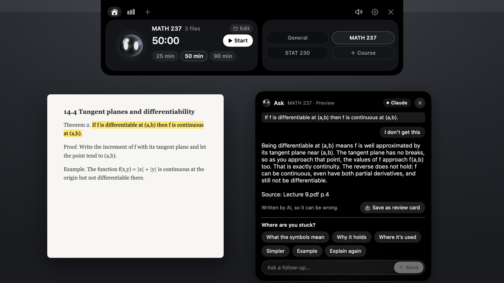
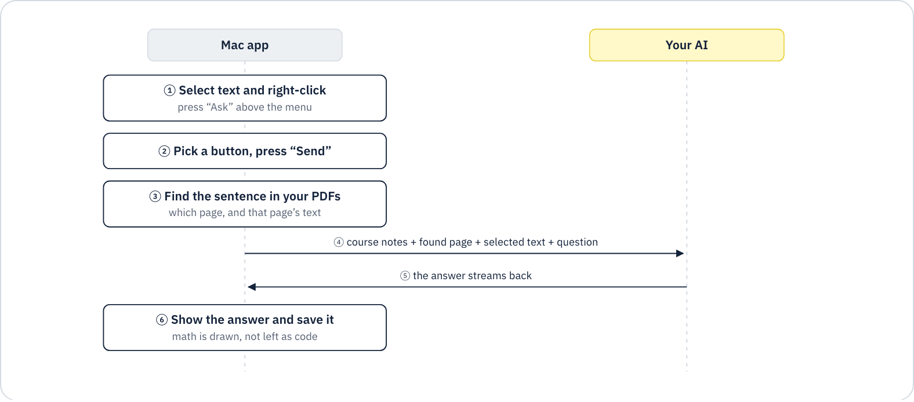
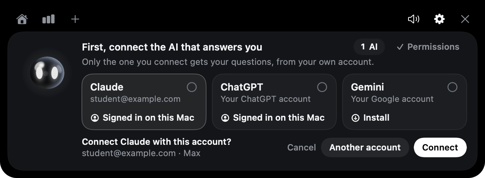
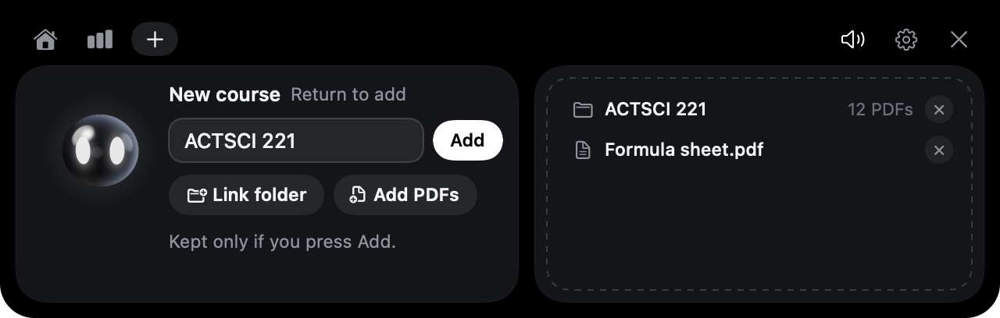

<p align="center"></p>
<h1 align="center">StudyNotch</h1>
<p align="center"><b>A study helper that lives in your Mac’s notch.</b></p>
<p align="center">
  Select a sentence in your lecture notes and right-click. StudyNotch finds that page in your course’s
  PDFs and asks the AI you already use, Claude, ChatGPT or Gemini, with your own account.
  The answer opens right where you were reading. No server: everything runs on your Mac.
</p>
<p align="center">
  <a href="https://studynotch.pages.dev"><b>Website</b></a> &nbsp;|&nbsp;
  <a href="#quick-start">Quick start</a> &nbsp;|&nbsp;
  <a href="#how-a-question-works">How a question works</a> &nbsp;|&nbsp;
  <a href="#connect-an-ai">Connect an AI</a> &nbsp;|&nbsp;
  <a href="#courses-and-their-files">Courses</a> &nbsp;|&nbsp;
  <a href="#what-leaves-your-mac">Privacy</a> &nbsp;|&nbsp;
  <a href="#docs">Docs</a>
</p>



<p align="center"><sub>The island and the question window are real screens, rendered by the app. The course, the page and the answer are examples.</sub></p>

## How a question works



The page your sentence is on goes along with the question, so the answer uses your professor’s notation and ends with the file and page it came from. A course’s PDFs are also the AI’s project: when that one page isn’t enough, the AI can open the rest of them itself, read-only.

## Quick start

Needs macOS 13 or later and Xcode or the Xcode command line tools (Swift 5.9 or later). There is no download yet; one command builds it.

```bash
git clone https://github.com/cpldxx/studynotch.git && cd studynotch
```

```bash
./scripts/build.sh && open build/StudyNotch.app
```

On first launch a card drops down from the notch, in two steps:

1. **Connect the AI that answers you.** Click Claude, ChatGPT or Gemini. A tile signs you in, installs or downloads what is missing, or, if it is already signed in on this Mac, asks “Connect … with this account?” and shows the account.
2. **Allow Accessibility** (to read the text you select) and, if you want “Capture and ask”, Screen Recording.

Then select some text anywhere, right-click, and press **Ask StudyNotch** above the menu.

## Connect an AI

<p align="center"></p>

| AI | What you need | How it answers | Tried for real |
|---|---|---|---|
| **Claude** | The Claude app, signed in | The Claude Code inside the app, in the background; each question is then kept in the Claude app under the course’s name | Yes |
| **ChatGPT** | The ChatGPT app, signed in | The Codex inside the app, read-only | Yes |
| **Gemini** | Homebrew; the tile installs Google’s Antigravity CLI (`agy`) | `agy`, signed in with Google | Not yet |
| **API key** | An Anthropic API key | Directly; the key stays in the Keychain | |

- Only the AI you connect gets your questions. Being signed in to an app on the Mac doesn’t connect it, and StudyNotch never switches to another AI on its own.
- **Another account** opens the service’s own sign-in page. That sign-in is kept only for StudyNotch, so the Claude and ChatGPT apps stay signed in as they were.
- **Test connection** sends one real question and shows the answer and how long it took.
- Questions go through each service’s own tool, so they count toward your plan.
- **With Claude, every question is kept in the Claude app**: as a Claude Code session under the course’s name, named after your question, with the answer. Follow-ups continue it, and **Open in Claude** opens it there. This uses the account the Claude app is signed in with; untick “Keep questions in the Claude app” in the menu bar icon to stop it.
- ChatGPT and Gemini questions aren’t kept in those apps. Chat Projects in Claude and ChatGPT can’t be read or filled by another app; a course is the AI’s project instead (below).

## Courses and their files

<p align="center"></p>

- **Link folder** links a folder you already keep. Its PDFs are read where they are; nothing is copied, and the folder is never written to.
- **Add PDFs** copies single PDFs into the course. Or drop PDFs or a folder onto the island.
- **StudyNotch sorts the files by itself**: course outline, lecture notes, course notes, assignments, quizzes, exams, exam prep, or other, from each file’s name, its folder’s name or the top of its first page. Copied PDFs move into a folder of that name; files in a linked folder stay where they are and are only grouped. Click a file’s kind on the Edit page to put it under another.
- **A course works like a project.** Every question in it gets the course’s notes, its files by kind and its memory: a line for each earlier question, kept in `memory.md` in the course’s folder. So an answer can say “you asked about this in Lecture 5” or point to the quiz that tests it. Delete a line there to have it forgotten.
- What you pick for a new course only waits in the list. **Add** makes the course; close the tab without it and nothing is kept.
- **Edit** on a course’s card changes it later: link or unlink folders, add or remove PDFs, rename it, or remove it. Removed things go to the Trash.

## While you study

- **Sessions.** Pick a course and press Start (25, 50 or 90 minutes). The time left stays beside the notch.
- **Drift cards.** Stay on a distracting site too long and a card says so. Nothing is blocked.
- **Capture and ask.** Ask about a screenshot, an area you drag out, or a diagram.
- **Squat**, the mascot, lives in the island. Its eyes follow your pointer and change with what is going on: focused, drifting, writing an answer, on a break.
- **Record.** Minutes, sessions and questions for today and the last seven days.

Answers come back in the language you type: ask in Korean and the answer is in Korean.

## What leaves your Mac

| Sent to the AI you connected, when you ask | Never sent |
|---|---|
| The selected text, or one capture | Which apps and sites you visited |
| Your course notes and the text of the matching page | Files in a linked folder that aren’t PDFs |
| The course’s memory (a line for each earlier question in it) and its file names by kind | |
| Any page of the course’s PDFs the AI opens to answer | Your password: every sign-in happens in the service’s own page |
| The app and window title you were reading in, and your question | |

With Claude, each question and its answer are also kept in Claude’s own session history on your Mac (`~/.claude/projects`), which is how the Claude app shows them. There is no StudyNotch server and no account.

## Docs

The full guide is the website, [studynotch.pages.dev](https://studynotch.pages.dev). Its source is [`site/`](site/), plain HTML with no build step, so `site/index.html` also opens straight from disk.

| Page | What is in it |
|---|---|
| [Get started](https://studynotch.pages.dev/docs/) | Building it, the first launch, adding a course and its files |
| [Connect an AI](https://studynotch.pages.dev/docs/connect) | Each AI, another account, where questions go, troubleshooting |
| [Using it](https://studynotch.pages.dev/docs/use) | The island, sessions, asking, drift cards, the mascot |
| [How it works](https://studynotch.pages.dev/docs/how-it-works) | The parts on the Mac, the order of one question, permissions |
| [Build log](https://studynotch.pages.dev/docs/build-log) | What changed and why, decisions, tests, the code layout |
| [Development](docs/development.md) | Building, the checks, the layout, settings and where data lives |
| [DESIGN.md](DESIGN.md) | Colours, type and the mascot, for the app and the site |

Built with Swift, SwiftUI, AppKit, Metal and PDFKit, with no outside libraries. The notch island follows [Coucou](https://github.com/Louis-CFM/coucou) (MIT); what was taken is in [THIRD_PARTY_NOTICES.md](THIRD_PARTY_NOTICES.md).

<sub>Claude and Claude Code are trademarks of Anthropic. ChatGPT and Codex are trademarks of OpenAI. Gemini and Antigravity are trademarks of Google. StudyNotch is not affiliated with any of them.</sub>
